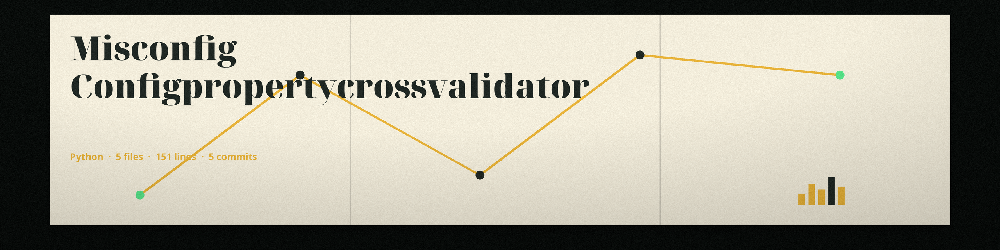

# misconfig-ConfigPropertyCrossValidator
Validates configuration properties against a known matrix of compatible values, identifying configurations that are likely to cause incompatibility issues. This helps to avoid problems during system upgrades or migrations. - Focused on Check for misconfigurations in configuration files or infrastructure definitions

## Install
`git clone https://github.com/ShadowGuardAI/misconfig-configpropertycrossvalidator`
`pip install -r requirements.txt`

## Usage
`python3 main.py config_file compatibility_matrix [-v] [-q]`

## Compatibility matrix format
The matrix is a JSON object. Each key is a property name and each value must be a JSON array of the allowed values for that property, for example `{"env": ["production", "staging"], "region": ["us", "eu"]}`. A scalar value such as `"production"` is rejected at load time with an error naming the property, because a plain membership test on a string would act as a substring test. An empty matrix, or a matrix that is not a JSON object, is a load error and exits 1: no properties would be checked, so no config is reported valid. A valid config exits 0 and a config with issues or a load error exits 1.

## Parameters
- `config_file`: Path to the configuration file to validate (YAML or JSON) (required positional).
- `compatibility_matrix`: Path to the JSON file containing the compatibility matrix (required positional).
- `-h, --help`: Show help message and exit
- `-v, --verbose`: Enable verbose logging.
- `-q, --quiet`: Suppress output except for errors.

## License
Copyright (c) ShadowGuardAI
